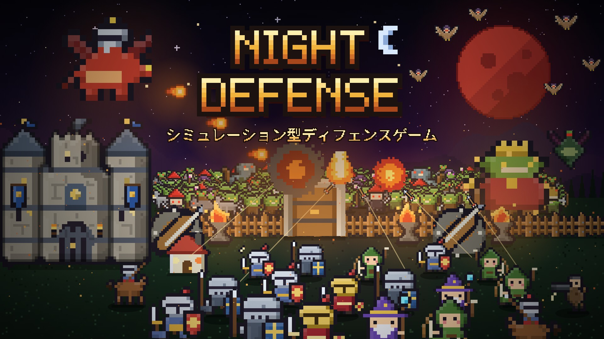

# ナイトディフェンス

シミュレーション型ディフェンスゲーム（ブラウザ版 / ver 1.11.1）

**遊ぶ：** https://negiramen1922.github.io/NIGHT-DEFENSE/

木材や石材、食料と住居を整え、兵士と防衛施設で夜ごとに押し寄せる魔物から街を守るドット絵のゲームです。
`index.html` 1ファイルだけで動きます（外部の読み込みなし）。セーブはブラウザ（localStorage）に保存されます。

- PC（Chrome / Edge / Firefox / Safari）とスマホ（横持ち）で遊べます
- スマホでも遊べます（横持ち推奨。縦向きのときは「横にしてください」と表示。「縦のまま遊ぶ」も選べます）
- ホーム画面に追加するとアプリとして全画面で遊べます（タイトルの「ホーム画面に追加」から。Android はインストール後は横向きで固定）
- 初めての方は、ステージ選択で「ステージ0 廃村エルム」を選ぶと、書記官リリアの案内（チュートリアル）つきで始まります

## ver 1.11.1

- 不具合の修正：昼に建てた1ターンの施設が、次の朝になっても完成していないことがあった。今は昼のいつ建てても次の朝に完成する
- 今はいない「近衛兵」の説明を消した

## ver 1.11

- 昼と夜が時間で進む（昼6分・夜6分）。生産は昼だけ、少しずつ入る。「夜へ」「朝へ」で残りの時間の分をまとめて受け取ってすぐ進める。残りは地図の上の横長のバーで
- 英雄の候補を内政と戦闘に分けた（内政2人・戦闘3人）
- 書記官リリアは領主様付きの書記官に（どの街を治めてもついて来る）

## ver 1.10

- 軽いストーリー（ステージ1）：始めにリリアが街とアビスのことを話す。第10・15・20・25・30・35襲撃を守りきった朝に、アビスの様子を伝える（先へ進むほど、はっきりしていく）。最後の結果の画面に終わりのことば
- 城のランクが上がったとき、リリアが「街をもっと大きくできますね！」と、新しく扱える素材（研究 → 施設を建てる → 集める）を案内する
- せりふ集（docs/LINES.md）

## ver 1.9

- 夜の出来事（訪問・夜中の事件）をポップアップで。使う前と後の量（「金貨 347 → 317」）が見える
- 祭りの花火を地図の上の街で。城の前に住民が集まって踊る
- タイトルに「世界の歴史」（これまでに治めた街の記録）。「記録」を開くときにリリアの読み込み画面
- 街の成長（タイムラプス）：新しく建った施設に青い波紋、強化された施設に金色の波紋
- 研究：新しい素材を集める研究と斥候を、列のいちばん上に黄色の枠で

## ver 1.8.4

- 複数の部隊をまとめて「固守」などに切り替えるボタンが効かないことがあったのを直した（消えたお知らせが上に残って、押せていた）

## ver 1.8.3

- 書記官リリアの絵：話す内容に合わせて表情が変わる。街の名前を決める画面に書斎のリリア。チュートリアルのあいだ、昼は城のそばをリリアが歩く

## ver 1.8.2

- チュートリアル：「街」のタブで生産と収支を見られること、街にいる英雄の見かたと配属のしかたを案内（画面の絵つき）
- チュートリアル：「兵士」のミッションの農兵を2部隊から1部隊に（最初の襲撃までに武器工房が間に合うように）
- 「街」のタブなどの数字を小数なしに

## ver 1.8.1

- 施設の詳しい画面の小さな動き（流れのカード）で、作る物が一瞬だけ見えてはすぐ消えていた不具合を修正
- 防衛施設の流れのカードで、矢などがないのに敵に当たっているように動いていた。今は「矢がないので撃てない」と出る
- 弾の使う量の表示を小数なしに

## ver 1.8 のおもな変更

- **タイトル画面**：後ろで、夜の襲撃を城壁でしのぐ街の様子が動くように。ボタンを減らして（つづきから・はじめから・モンスター図鑑・アップデート情報）、スクロールしなくても全部見えるように
- 右下に「遊び方」と**設定（⚙）**：BGM・効果音の音量、消音、**音楽室**（ゲームの曲を聴ける）、クレジット、ホーム画面に追加
- 旧版（ver 0.9）へのボタンをなくした

## ver 1.7 のおもな変更

- **チュートリアルを作り直し**（ステージ0 廃村エルム）：書記官リリアが「領主様」に話しかけて、9つのミッションで基本を案内する（生産施設の建設 → 人 → 研究 → 防衛 → 兵士 → 英雄と熟練度 → 軍需 → 夜と朝 → 城のレベル上げ）。実際に手を動かして進める。説明には動く絵、柵の一列置きと部隊の移動は操作の動画つき。はじめての夜には昼と夜の流れの説明
- **番外編「偵察と駐屯地攻め」**：街が育ったところから始めて、斥候で駐屯地を見つけ、夜襲をかけるまでを覚える
- **街の名前**を決められるように。結果の画面・街の記録・タイムラプス（「○○の歴史」）に出る
- 廃村エルムの廃墟をなくした
- **研究員**：研究のたびに待機中の住民を使うのをやめた。城に5人、研究室を建てると3人が研究員としてつく
- **新しくできるようになったことの知らせ**：城のレベルが上がったとき・研究で新しい施設を建てられるようになったとき、アイコンつきで画面の上に出す
- エーテル採掘所は、研究「エーテル採掘」（ランクⅡ）から
- **山場の前は準備が6日**：ブラッドムーンと大きな夜の前だけ、襲撃までの日数を4日から6日に
- **上のお知らせ**：英雄の戦死・城への攻撃・城が危ないとき・大きな夜の知らせ（5日前と前の日）と、その夜の始まり
- 兵科の「兵士」を**剣士**に

## ver 1.6 のおもな変更

- **前の襲撃のあとからやり直す**：負けたとき、ひとつ前の襲撃をしのいだあとから始め直せる。負けの画面に「この襲撃で起きたこと」（矢が尽きた回数など）も出る
- **足りない資源の警告**：夜へ進む前に、襲撃で足りなくなりそうな資源を「夜へ」の横に出す
- **序盤の敵を減らした**（第1〜第9襲撃）
- **施設の流れ**：施設の詳しい画面に「使う物 → 作る物」、地図の表示切り替えに「生産」、採集施設に埋蔵量のバー
- 上の帯の「推奨」の目安を外した（足りない資源の警告に置き換え）
- ステージ選択に、ステージ2の解放の条件（ステージ1で第10襲撃をしのぐ）といまの記録
- **ブラッドムーン**は5回ごと、ボスの夜（第20・第40）は外す。ワーウルフは第25襲撃から。後半のブラッドムーンの敵の数を控えめに
- 言葉を「**駐屯地**」にそろえた
- セーブを小さく（約4分の1）

## ver 1.5 のおもな変更

- **街の記録**：「記録」ボタン（スマホは「街の記録」）で、襲撃ごとの結果と、施設の数・生産量・資源の移り変わりをグラフで見られる（5回ごとの襲撃の目印つき）。「数字をコピー」で表計算ソフトに貼れる
- **街の成長のタイムラプス**：ゲームの終わり（勝っても負けても）や街の記録から、最初の日からの街の移り変わりを本物の絵で早送り
- **iPad などタブレット**で指で遊びやすく：キーの案内を隠す・ボタンを大きく・範囲選択ボタン。ダブルタップで画面が拡大されないように（どの端末でも）
- 不具合の修正：建設する施設を選んでも、上の帯に名前・費用・置き方が出ないことがあった（1.4.2〜1.4.3）

## ver 1.4.3 のおもな変更

- **矢・武具などの消費を元に戻した**（1.4.1 で約130%にしたもの。第6襲撃あたりで矢が途中で尽き、守れなくなることがあった）
- **BGM を 8bit 風に**：ホーム・昼・静かな夜・祭り・襲撃の曲を新しく。ブラッドムーンの夜に専用の曲、勝ったとき・負けたときの結果画面に曲。ボスの曲はそのまま
- **効果音を作り直し**：建設（木・石・金属・火・畑）、研究、敵を倒す（ザシュッ）、騎兵の突撃（バシン）、襲撃の知らせ、しのいだとき・勝利・敗北のファンファーレ など
- 軽量化：明かりの中かの判定を区画ごとに、夜の闇は画面が動かなければ4コマに1回作り直す

## ver 1.4.2 のおもな変更

- **罠もドラッグで一列にまとめて置ける**ように（壁と同じ操作）
- **取り消し**：さっき置いたもの（ドラッグで置いた一列はまるごと）を全額返して戻せる。建設中の帯の「取り消し」か Ctrl+Z。その日のうち（ターンを進めるか襲撃が始まるまで）なら何回でも
- 罠を押すと**撤去**できるように（費用の半分が戻る）
- 改築中の残りターンを建物の枠の中に出して、密集した街でも重ならないように

## ver 1.4.1 のおもな変更

- **軽量化**：夜の描画を大幅に軽く（敵の多い襲撃で約3倍軽く）。地形・霧・施設は画面に見えている所だけ描く
- 敵の地上部隊が **10〜20体の群れ** でまとまって押し寄せるように（数は同じ。第3襲撃から）
- **範囲攻撃は爆心から離れるほど弱く**（中心100%・端40%）。群れにまとめて当てたときに強くなりすぎないように
- 部隊の補給・補充・手当てを **前哨砦・城館でも** 受けられるように（いちばん近いところへ行く。装備の付け替えは所属施設だけ）
- 矢・武具・魔力などの消費を約130%に。石炭と関係のない研究（農業・魔法・訓練・偵察・石や木の工事など）には石炭を使わない
- **改築中・城の強化中** がマップで分かるように（建物の上に残りターンと進み具合）
- 研究画面：改築の研究を各ランクのいちばん上に
- 祭りの費用を人口に合わせた（人口×0.4金貨、最低10）
- 盾持ちオーガなど、敵の向きが左右にパタパタ変わる不具合を修正

## ver 1.4 のおもな変更

- **駐屯地襲撃モード β**：ステージ選択で ON/OFF。ON にすると、見つけた駐屯地に部隊が近づいたとき、別の戦場で夜襲をかけて戦う（連れて行く部隊を選ぶ。倒した魔物の分だけ次の襲撃が減り、部隊の被害は残る。1日1回）。OFF だと駐屯地には攻め込めない。陣は襲撃が進むほど大きくなる（小さな陣→中くらいの陣→大きな陣→砦→大要塞）
- ステージ1の名前を **グレイヴェル平原** に
- **モンスター図鑑** をタイトルへ（セーブをまたいで記録が残る）。立ち絵が少し動くように
- **アップデート情報** をタイトルから見られるように
- 上の資源の表示：新しい資材が増えても入りきるように詰めて表示。石炭・合金のアイコンを見やすく
- 襲撃の曲を40回の襲撃に合わせて、ランクが上がるごとに盛り上がるように

## ver 1.3 のおもな変更

- **ステージ1（草原）を40回の襲撃まで**：ランクⅠ〜Ⅶまで街を育てて戦える。20回目に中ボス「ゴブリンキング」（王の号令・王の招集）、40回目にラスボス「蠢く木陰」（宵闇の帳・森の抱擁・第二形態の森の胎動）
- **ステージ選択**：ステージ0 チュートリアル・ステージ1 草原が遊べる。沼地・山脈・雪原・荒野は Coming Soon
- **新しい魔物**：トレント・エルダートレント・盾持ちオーガ・マンイーター（色違い）・吸血鬼・グール・ストーンゴーレム・ワーウルフ。ゴブリンの服装違い
- **ランクⅠ〜Ⅶ**：城Lv7まで。新しい素材（石炭・金・合金・魔金属・聖銀・竜晶）、施設の改築（材料が変わって見た目も変わる）
- **新しい防衛施設・罠**：風船爆弾・メイジの塔・バリアストーン・テスラタワー・ハープーンランチャー・ミスリルレイ・ドラゴンブレス、魔金属・龍鱗の壁、エーテル爆弾・重力の罠・聖銀の杭・メテオコール
- **新しい部隊**：エーテルゴーレム・狙撃兵・銀装兵・グリフォン騎兵
- **絵**：施設・部隊・魔物の新しいドット絵と立ち絵
- **図鑑**：特徴に名前（乾いた樹皮・大盾・毒液など）。数字は小数なしで表示

## ver 1.2 のおもな変更

- **夜の過ごし方**：静かな夜に「休む・宴・祈り・夜警を厚く・夜なべ」から1つ選ぶ。夜狩りは参加する部隊が1つの一団で出る（まとめるほど安全）。残った部隊は夜警になる
- **夜の出来事**：旅人の一家・祭りの企画（次の夜は祭りと花火）・行商人（珍しい品を3つ）・流れ星・赤い月の予告が訪ねてくる。幸福度が低いと、夜中に火事やネズミ・脱走などの事件が起きやすい（夜警が多いと被害が小さい）
- **幸福度**：何日か続く上乗せ（祭り・宴など）、幸福度の顔アイコン
- **教会**（3×3）：幸福度が上がり、夜の祈りが強くなる
- **熟練度**：部隊の詳細に経験値のバー、段階ごとのアイコン。夜狩りでも経験が入る
- **罠の見直し**：罠は1×1。罠の数に上限（城Lvで50〜150）。トゲ床はダメージを下げ、踏まれ続けると壊れる（一括修理で直す）。落とし穴は襲撃のあとに自動で掘り直し、一括修理でも直る
- **市場**：つまみと矢印で量を決めて売り買い（使う量・手に入る量を表示）。足りない資源に「市場で買う」ボタン、市場の詳細に買い物の目安
- **武器工房**：地図の上に作っているもの（矢・剣）を表示、軍事タブで切り替え
- **操作**：部隊を範囲でまとめて選んで指示（PCは Shift＋ドラッグ）。補給に戻った部隊は元の場所・元の指示に戻る。駐屯地の戦いは×1・一時停止で始まる
- **画面**：建設の分類タブ、PCの下のボタンの並び替え（倍速は押すたびに切り替え）、詳細と下のパネルの高さを変えられる、敵情の帯をたたむ、襲撃中の敵情を小さく、夜の画面に持っている資材を表示
- **セーブ**：昼と夜の切り替えでオートセーブ、右下にセーブの表示
- **読み込み**：ゲームロゴと歩く英雄たちの読み込み画面。始めるときの固まりを軽く（スマホで約8秒→約2秒）
- 畑の研究名（土の改良・品種改良）、研究「槍穴」をランク2へ

## ver 1.1 のおもな変更

- スマホ横持ちに対応（右にボタンを縦に並べ、詳細・建設は右から引き出すパネル）。Android は横向きに固定、iPhone は横にするよう案内
- ホーム画面に追加してアプリとして遊べるように（全画面・オフラインでも起動）
- スマホの建設を「タップで仮置き → 十字キーで1マスずつ調整 → 決定」に
- タブを 建設・研究・軍事・街 に整理。部隊・訓練・英雄・冒険者は「軍事」にまとめた
- 城の強化・魔核強化・造り替えにターンがかかるように。施設の数に上限（城と前哨砦で増える）
- 駐屯地の案内、襲撃で敵を全滅させたら次の波を前倒し、遠くの敵の早送りを控えめに
- 冒険者にも補給（武具・矢・エーテル）が必要に。部隊の一覧に補給の残り（％）のバー
- 一括補給・一括修理で使う素材を表示、足りない素材は赤字
- セーブから再開すると霧（見た範囲）がおかしくなる不具合などを修正
- 研究画面の上に研究中のものを表示（押すとその研究へ移動）。進み具合はターンの数の棒で、研究員はアイコンで表示。スマホ横持ちの研究画面を見やすく
- 画面の中のボタンを押しても、スクロールが一番上に戻らないように（夜の画面など）

## ver 1.0 のおもな変更

- 画面デザインを一新（ドット書体 DotGothic16〔SIL OFL 1.1〕を必要な文字だけ埋め込み、資源・操作アイコンはドット絵）
- ユニット・施設・魔物・投射物・エフェクトのドット絵を描き直し（歩く・攻撃・発射のアニメーション付き）
- マップを150%に広げ、マス目を細かく（基本の施設 2×2、大きな施設 3×3、城 4×4、壁・柵・篝火 1×1）
- 敵の駐屯地：アビスから出た魔物は、街とのあいだで次の襲撃を待つ。斥候で見つけ、昼のうちに部隊で叩ける
- 新しい部隊「斥候」、英雄スキルの作り直し、騎兵の突撃、モンスター図鑑、壁の一括設置・修繕
- マップの表示切り替え（通常／土地Lv／狙われやすさ）

## 旧版（ver 0.9）

旧版は `v0.9/` で遊べます（タイトル画面からのボタンは ver 1.8 でなくしました）。
旧版と新版のセーブは別々に保存されるので、どちらの続きもそのまま遊べます。

## ファイル構成

- `index.html` … 最新版
- `siege.js` … 駐屯地襲撃モード β（夜襲の戦場）
- `tut/` … チュートリアルの操作の動画と、タイトル画面の後ろの動画（`title.mp4`）
- `proto/` … 試作版（次の更新を試す場所。セーブは本番と別）
- `v0.9/index.html` … 旧版（ver 0.9）
- `ogp.jpg` … URLを貼ったときに出る画像（1200×675）
- `keyvisual.jpg` … キービジュアル（1920×1080）
- `.nojekyll` … GitHub Pages でそのまま配信するための空ファイル
- `manifest.webmanifest`・`sw.js`・`icon-*.png`・`apple-touch-icon.png` … ホーム画面に追加（アプリ化）するためのファイル

更新するときは、新しい `index.html` を同じ場所に置き換えるだけです（プレイヤーのセーブはそのまま残ります）。
