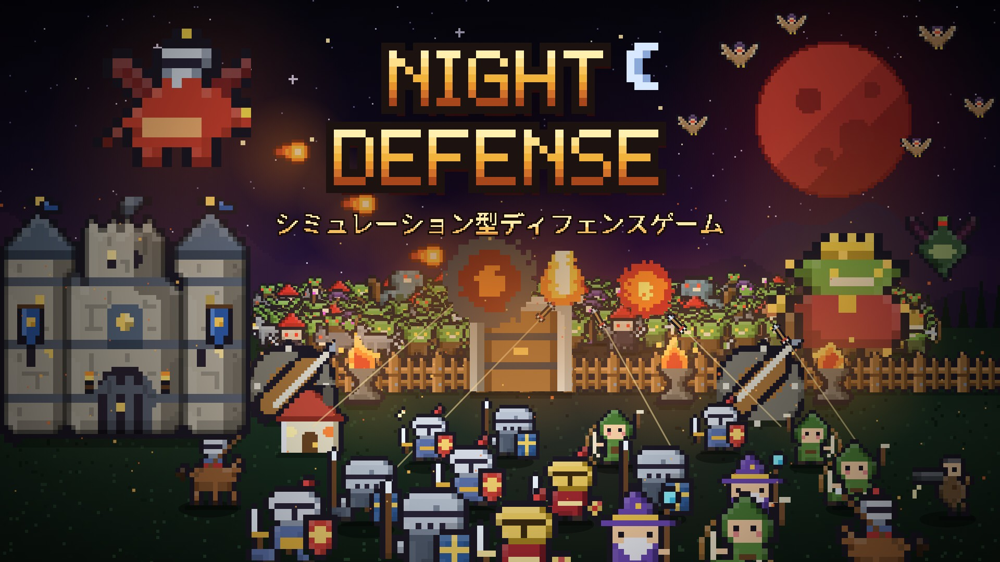

# ナイトディフェンス

シミュレーション型ディフェンスゲーム（ブラウザ版 / ver 1.1）

**遊ぶ：** https://negiramen1922.github.io/NIGHT-DEFENSE/

木材や石材、食料と住居を整え、兵士と防衛施設で夜ごとに押し寄せる魔物から街を守るドット絵のゲームです。
`index.html` 1ファイルだけで動きます（外部の読み込みなし）。セーブはブラウザ（localStorage）に保存されます。

- PC（Chrome / Edge / Firefox / Safari）とスマホ（横持ち）で遊べます
- スマホでも遊べます（横持ち推奨。縦向きのときは「横にしてください」と表示。「縦のまま遊ぶ」も選べます）
- ホーム画面に追加するとアプリとして全画面で遊べます（タイトルの「ホーム画面に追加」から。Android はインストール後は横向きで固定）
- 初めての方は、マップ選択で「廃村エルム」を選ぶと手引きつきで始まります

## ver 1.1 のおもな変更

- スマホ横持ちに対応（右にボタンを縦に並べ、詳細・建設は右から引き出すパネル）。Android は横向きに固定、iPhone は横にするよう案内
- ホーム画面に追加してアプリとして遊べるように（全画面・オフラインでも起動）
- スマホの建設を「タップで仮置き → 十字キーで1マスずつ調整 → 決定」に
- タブを 建設・研究・軍事・街 に整理。部隊・訓練・英雄・冒険者は「軍事」にまとめた
- 城の強化・魔核強化・造り替えにターンがかかるように。施設の数に上限（城と前哨砦で増える）
- 駐留地の案内、襲撃で敵を全滅させたら次の波を前倒し、遠くの敵の早送りを控えめに
- 冒険者にも補給（武具・矢・エーテル）が必要に。部隊の一覧に補給の残り（％）のバー
- 一括補給・一括修理で使う素材を表示、足りない素材は赤字
- セーブから再開すると霧（見た範囲）がおかしくなる不具合などを修正

## ver 1.0 のおもな変更

- 画面デザインを一新（ドット書体 DotGothic16〔SIL OFL 1.1〕を必要な文字だけ埋め込み、資源・操作アイコンはドット絵）
- ユニット・施設・魔物・投射物・エフェクトのドット絵を描き直し（歩く・攻撃・発射のアニメーション付き）
- マップを1.5倍に広げ、マス目を細かく（基本の施設 2×2、大きな施設 3×3、城 4×4、壁・柵・篝火 1×1）
- 敵の駐留地：アビスから出た魔物は、街とのあいだで次の襲撃を待つ。斥候で見つけ、昼のうちに部隊で叩ける
- 新しい部隊「斥候」、英雄スキルの作り直し、騎兵の突撃、モンスター図鑑、壁の一括設置・修繕
- マップの表示切り替え（通常／土地Lv／狙われやすさ）

## 旧版（ver 0.9）

旧版は `v0.9/` で遊べます（タイトル画面の「旧版（ver 0.9）で遊ぶ」からも開けます）。
旧版と新版のセーブは別々に保存されるので、どちらの続きもそのまま遊べます。

## ファイル構成

- `index.html` … 最新版（ver 1.1）
- `proto/` … 試作版（次の更新を試す場所。セーブは本番と別）
- `v0.9/index.html` … 旧版（ver 0.9）
- `ogp.jpg` … URLを貼ったときに出る画像（1200×675）
- `keyvisual.jpg` … キービジュアル（1920×1080）
- `.nojekyll` … GitHub Pages でそのまま配信するための空ファイル
- `manifest.webmanifest`・`sw.js`・`icon-*.png`・`apple-touch-icon.png` … ホーム画面に追加（アプリ化）するためのファイル

更新するときは、新しい `index.html` を同じ場所に置き換えるだけです（プレイヤーのセーブはそのまま残ります）。
